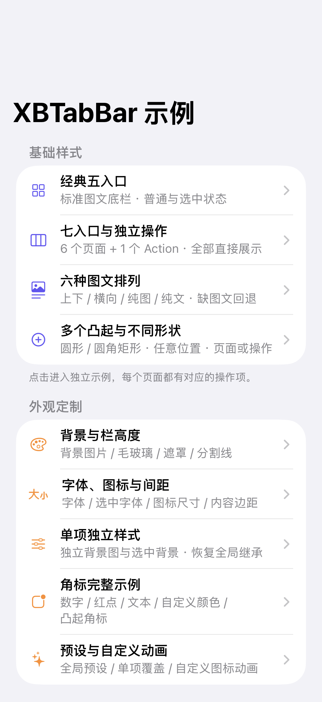
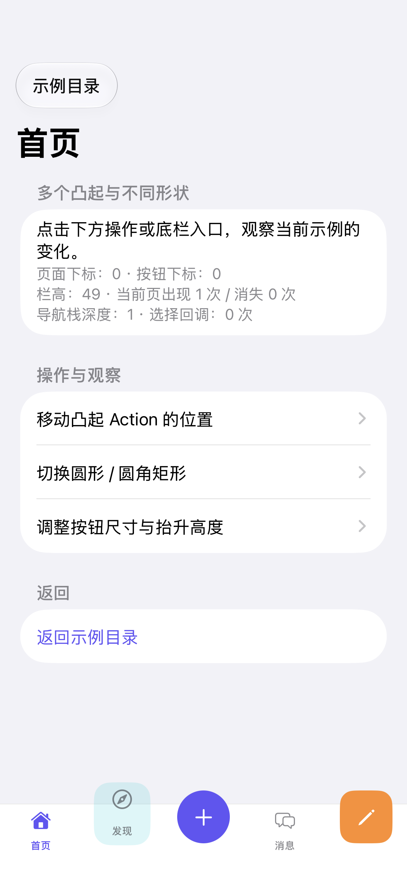

# XBTabBar

Objective-C 多入口底栏组件，最低 iOS 15，依赖 UIKit、Masonry。支持超过五个入口全部直显、独立导航栈、凸起按钮、Action、角标、六种图文布局及点击动画。

组件版本 **0.1.0**，Demo 版本 **0.2.0**。组件不依赖项目 PCH、主题、权限或网络逻辑；Demo 内置 Masonry，可离线运行。

## 预览

 

## 接入组件

将 `XBTabBar/` 中六个 `.h/.m` 文件加入目标工程，并链接 Masonry。也可以使用 CocoaPods 安装 Masonry：

```ruby
pod 'Masonry', '~> 1.1'
```

```objc
#import "XBTabContainerViewController.h"

XBTabContainerViewController *tabs = [XBTabContainerViewController new];
UINavigationController *home = [[UINavigationController alloc]
    initWithRootViewController:[UIViewController new]];
UINavigationController *mine = [[UINavigationController alloc]
    initWithRootViewController:[UIViewController new]];
XBTabBarItem *homeItem = [[XBTabBarItem alloc]
    initWithIdentifier:@"home" title:@"首页"
    image:[UIImage systemImageNamed:@"house"]
    selectedImage:[UIImage systemImageNamed:@"house.fill"]];
XBTabBarItem *mineItem = [[XBTabBarItem alloc]
    initWithIdentifier:@"mine" title:@"我的"
    image:[UIImage systemImageNamed:@"person"]
    selectedImage:[UIImage systemImageNamed:@"person.fill"]];
[tabs setViewControllers:@[home, mine] tabBarItems:@[homeItem, mineItem]];
self.window.rootViewController = tabs;
```

单项配置查询和外观读取均返回副本，修改后通过 `updateItem:` 或重新赋值应用。所有 UI 和配置更新在主线程执行。

完整能力、委托回调、角标、布局和导航接入说明见 [组件文档](XBTabBar/README.md)。Swift 接入可参考 [Swift 示例](Demo/SwiftInteropCheck.swift)。

## 运行

打开 `XBTabBarDemo.xcodeproj`，选择 `XBTabBarDemo` scheme 与模拟器，按 ⌘R。应用先展示 **示例目录**，点击 cell 进入对应样式或功能页。

- 目录使用四个分组、18 个入口，每个专题独立保存当前配置。
- 底栏容器示例全屏打开，在导航栏点击“示例目录”返回；独立视图、多容器和接入页通过系统导航进入并返回。
- 空配置及纯 Action 页面提供“恢复三个页面入口”和“返回示例目录”。
- 原版全部快捷控制项保留在“综合交互面板”。

真机运行需自行选择 Development Team。组件 / Demo 部署目标是 iOS 15；XCTest target 最低 iOS 17，以匹配当前 Xcode 测试运行库。

## 目录与能力

| 分组 | 示例 | 可操作或观察的内容 |
| --- | --- | --- |
| 基础样式 | 经典五入口 | 普通 / 选中配色、深浅色 |
| 基础样式 | 七入口与独立操作 | 4 / 7 入口、Action 移位、独立操作不切页 |
| 基础样式 | 六种图文排列 | 上下、横向、纯图、纯文、缺图文、RTL |
| 基础样式 | 多个凸起与不同形状 | 多个 Action、凸起页面、圆形 / 圆角、尺寸 / 抬升 |
| 外观定制 | 背景与栏高度 | 背景图、普通毛玻璃、调色遮罩、49 / 64 / 80 栏高、分割线 |
| 外观定制 | 字体、图标与间距 | 普通 / 选中字体、图标大小、图文间距、内容边距 |
| 外观定制 | 单项独立样式 | 单项背景图 / 背景色、独立布局、恢复全局继承 |
| 外观定制 | 角标完整示例 | 数字、红点、NEW、长文本、隐藏、颜色 / 高度、凸起角标 |
| 外观定制 | 预设与自定义动画 | 全局预设、单项预设、自定义旋转回调 |
| 交互与容器 | 动态文案与图片 | 标题、普通 / 选中图片、禁用 / 启用 |
| 交互与容器 | 选择、拦截与静默定位 | 准入、重复点击、标识选择、下标 / 对象静默定位 |
| 交互与容器 | 入口增删与重建 | 重排、增删、新控制器对象、清空、纯 Action、恢复 |
| 交互与容器 | 导航栈与底栏隐藏 | 保留底栏切换独立导航栈、Push 隐藏、返回完成 / 取消 |
| 交互与容器 | 独立使用 XBTabBarView | 页面内嵌、外部处理点击 / 准入 / 动画、隐藏、禁用 |
| 交互与容器 | 多个容器独立运行 | 上下两个容器的选中状态和外观隔离 |
| 适配与接入 | 布局方向与辅助功能 | RTL、深浅色、读取 VoiceOver / 减少动态效果 / 减少透明度状态 |
| 适配与接入 | 解码初始化与 Swift 接入 | 真正经过 initWithCoder: 创建，真正由 Swift 工厂创建后打开 |
| 适配与接入 | 综合交互面板 | 原版全部快捷控制项 |

RTL 是从右向左布局，常用于阿拉伯语等语言的适配。底栏视觉顺序和横排图文镜像，页面身份及下标含义保持不变。

## 源码入口

- `Demo/XBCatalogController.m`：目录数据、cell、示例路由。
- `Demo/XBShowcaseController.m`：各专题底栏配置与操作，页面可观察回调次数及出现 / 消失次数。
- `Demo/XBEmbeddedExamples.m`：独立按钮栏、双容器、解码与 Swift 接入页面。
- `Demo/XBDemoController.m`：原版综合交互面板。
- `Demo/SwiftInteropCheck.swift`：Swift 创建示例及 Objective-C 可调用的工厂。
- `XBTabBar/`：组件源码和接入说明。
- `Tests/XBTabBarTests.m`：原组件的 13 项回归测试。
- `Tests/XBDemoCatalogTests.m`：目录和扩展 Demo 的 7 项集成检查。
- `Documentation/`：目录及示例页运行截图。

## 验证

在 Xcode 按 ⌘U 执行 20 项测试。验证记录见 [Verification.md](Verification.md)，截图索引见 [Documentation/README.md](Documentation/README.md)。

```sh
xcodebuild -project XBTabBarDemo.xcodeproj -scheme XBTabBarDemo \
  -sdk iphonesimulator -destination 'generic/platform=iOS Simulator' \
  -derivedDataPath /tmp/XBTabBarDemo-build CODE_SIGNING_ALLOWED=NO build-for-testing

# 将 name 替换为本机可用模拟器名称。
xcodebuild -project XBTabBarDemo.xcodeproj -scheme XBTabBarDemo \
  -destination 'platform=iOS Simulator,name=iPhone 18 Pro' \
  -derivedDataPath /tmp/XBTabBarDemo-build CODE_SIGNING_ALLOWED=NO test
```

交互返回取消、iPad / 旋转 / 极窄窗口以及系统辅助功能运行时切换，仍需实际体验检查。iOS 15 已作为部署目标构建，当前未在 iOS 15 运行。

组件说明见 [XBTabBar/README.md](XBTabBar/README.md)，版本记录见 [CHANGELOG.md](CHANGELOG.md)。XBTabBar 和 Demo 使用 MIT 许可，Masonry 保留 [原始许可](Vendor/Masonry/LICENSE)。当前以源码和离线 Demo 交付。
